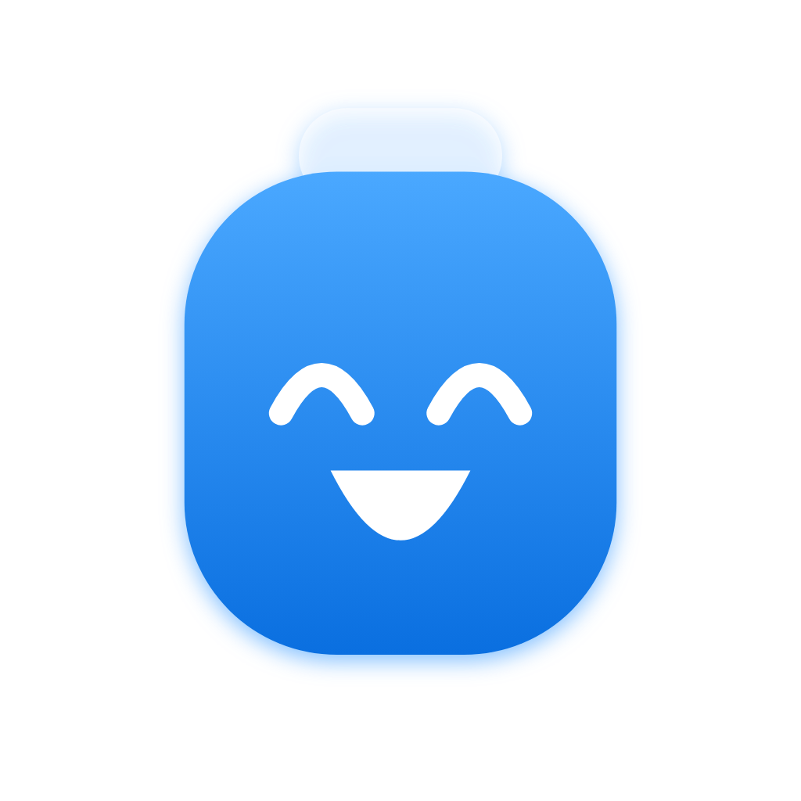

<div align="center">



# ✂️ ClipSnap 🪟

**One menu bar icon, two superpowers:** a lightning-fast **clipboard manager** and an intuitive **window snapper** for macOS.

Native Swift & SwiftUI • macOS 14+ • Zero dependencies • 100% offline & private

[](https://github.com/balshaansingh29/ClipSnap/releases/latest)
[](https://www.apple.com/macos/)
[](https://swift.org)
[](LICENSE)

[📦 Download ClipSnap v1.0 (.dmg)](https://github.com/balshaansingh29/ClipSnap/releases/download/v1/ClipSnap-v1.dmg) • [✨ Features](#-features) • [🚀 Getting Started](#-getting-started) • [⌨️ Shortcuts](#-shortcuts)

---

</div>

## ✨ Features

### 📋 Smart Clipboard History
- 🔍 **Instant Search:** Type to filter through text, rich text (RTF), and image clips in real-time.
- 📌 **Pin Favorites:** Pin frequently used clips to keep them at the top of your list.
- ⚡️ **Quick Paste:** Press `⌘1`–`⌘9` to paste items immediately, or `⌥↩` for plain text.
- 🛡️ **App Exclusion:** Automatically ignores sensitive apps like password managers.

### 🪟 Seamless Window Snapping
- 📐 **Flexible Layouts:** Snap windows into halves, thirds, two-thirds, quarters, or full screen.
- 🔄 **Cycle Sizes:** Repeat half or third shortcuts to effortlessly cycle through `½` → `⅔` → `⅓`.
- 🧲 **Edge & Corner Drag:** Drag windows to display edges or corners with live footprint previews.
- 👋 **Shake to Snap:** Shake your cursor while dragging a window to summon a quick layout palette right at your pointer.

### 🎨 Delightful Details
- 🐾 **Snip the Mascot:** An interactive, code-rendered companion that blinks, rests when paused, and celebrates your copies!
- 🔔 **Subtle HUD:** Minimal floating feedback badges confirm your paste or snap actions.
- 🧭 **Interactive Welcome Tour:** First-launch walkthrough to help you get productive in seconds.

---

## 🚀 Getting Started

### 📥 Option 1: Download Release (Recommended)

1. Grab the latest [**ClipSnap v1.0 DMG**](https://github.com/balshaansingh29/ClipSnap/releases/download/v1/ClipSnap-v1.dmg).
2. Open `ClipSnap-v1.dmg` and drag **ClipSnap** to your **Applications** folder.
3. Launch ClipSnap from Applications or Spotlight.

> [!IMPORTANT]
> **Accessibility Permission Required:**  
> On first launch, grant **Accessibility** access under **System Settings → Privacy & Security → Accessibility**.  
> This allows ClipSnap to reposition other application windows and synthesize `⌘V` paste commands.

---

### 🛠️ Option 2: Build from Source

Requirements: macOS 14.0+ and Xcode Command Line Tools.

```bash
# Clone the repository
git clone https://github.com/balshaansingh29/ClipSnap.git
cd ClipSnap

# Build universal application
./build.sh

# Launch the app
open build/ClipSnap.app
```

> [!TIP]
> To preserve Accessibility permissions across local rebuilds, sign with a stable local certificate:  
> `SIGN_ID="My Local Cert" ./build.sh`

---

## ⌨️ Shortcuts

### 📋 Clipboard Controls
| Action | Shortcut |
|---|---|
| Open ClipSnap Popover | `⌃` `⇧` `V` |
| Filter clips | Type query |
| Navigate list | `↑` / `↓` |
| Paste selected item | `↩` |
| Paste as plain text | `⌥` `↩` (or `⌥`-Click) |
| Quick paste (items 1–9) | `⌘` `1`–`9` |
| Pin / Unpin item | Right-Click |
| Delete item | `⌘` `⌫` |
| Pause / Resume capture | Right-Click menu bar icon |

### 🪟 Window Snapping Controls
| Layout Action | Shortcut |
|---|---|
| Left / Right Half (cycle `½` → `⅔` → `⅓`) | `⌃` `⌥` `←` / `→` |
| Top / Bottom Half | `⌃` `⌥` `↑` / `↓` |
| Quarters (Corners) | `⌃` `⌥` `U` / `I` / `J` / `K` |
| Thirds (Left / Center / Right) | `⌃` `⌥` `D` / `F` / `G` |
| Maximize | `⌃` `⌥` `↩` |
| Center Window | `⌃` `⌥` `C` |
| Restore Previous Frame | `⌃` `⌥` `⌫` |

### 🧭 Navigation & Tabs
| Action | Shortcut |
|---|---|
| Switch to Clipboard tab | `⌘` `⌥` `1` |
| Switch to Windows tab | `⌘` `⌥` `2` |
| Switch to Settings tab | `⌘` `⌥` `3` |

---

## 🏗️ Project Architecture

```
Sources/ClipSnap/
├── Clipboard/      # ClipItem, ClipStore, ClipboardMonitor, Paster
├── Snapper/        # WindowAction, AXWindow (Accessibility), DragSnapper, ScreenGeometry
├── Core/           # AppDelegate, AppModel, HotkeyCenter, Bindings, Settings
└── UI/             # Theme tokens, RootView, ClipboardView, SnapView, SettingsView, Mascot (Snip)
```

---

## 📄 License

Distributed under the MIT License. See [LICENSE](LICENSE) for details.
